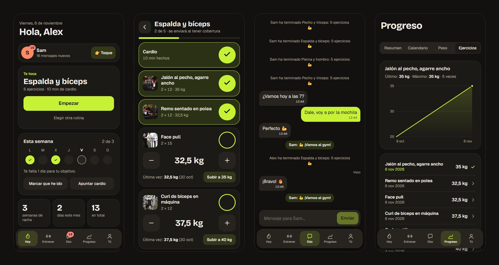

# Dúo

App web para que dos personas lleven juntas su progreso en el gym: rutinas, pesos, cardio, calendario, mensajes y toques con notificaciones. Se puede instalar en el móvil y funciona sin cobertura, algo necesario en muchos gimnasios.

La hice para mi pareja y para mí al volver al gym: las apps de este tipo limitan funciones en su plan gratis y no están pensadas para seguir el progreso entre dos personas.



## Funcionalidades

- **Entrenar con un toque:** eliges día y rutina, y marcas cada ejercicio con un botón grande.
- **Memoria de pesos:** cada ejercicio empieza con el último peso usado y un selector que solo pasa por pesos habituales de gimnasio, sin teclado.
- **Sin cobertura:** lo que apuntas se guarda en el móvil y se envía solo cuando vuelve la conexión.
- **En pareja:** mensajes, toques para ir al gym, avisos al terminar un entreno y comparativa de estadísticas.
- **Privacidad por persona:** cada cuenta decide qué comparte. El servidor no entrega lo demás.
- **Rutinas personalizables:** incluye una rutina de aclimatación de 3 días y un catálogo de 855 ejercicios con nombres en español.
- **Progreso:** calendario, rachas, evolución por ejercicio, cardio y peso corporal.
- **Sesión persistente:** se entra una vez y la sesión se renueva sola al usar la app.

## Tecnología

| Capa | Herramientas |
|---|---|
| Web | React 19, TypeScript, Vite, TanStack Query, Motion, CSS propio |
| PWA | Service worker propio, Web Push, cola de envíos sin conexión |
| API | Hono sobre Cloudflare Workers |
| Datos | Cloudflare D1 (SQLite) con migraciones |
| Pruebas | Vitest, prueba de API con curl y recorrido de navegador con Puppeteer |

Todo funciona en el plan gratuito de Cloudflare.

## Detalles técnicos destacados

- **Notificaciones push sin librerías:** cifrado RFC 8291 y firma VAPID RFC 8292 con WebCrypto, comprobados con el vector de ejemplo de la especificación.
- **Sincronización idempotente:** cada envío lleva un identificador creado en el móvil, así que repetirlo tras un corte no duplica datos.
- **Autorización en el servidor:** una prueba comprueba que una cuenta no puede leer ni modificar los datos de otra y que lo no compartido no se entrega.
- **Sesiones seguras:** cookie `HttpOnly` de 400 días con renovación automática; en la base de datos solo se guarda su hash.

## Documentación

| Documento | Contenido |
|---|---|
| [Arquitectura](docs/arquitectura.md) | Cómo encajan las piezas y cómo viaja un dato |
| [Decisiones técnicas](docs/decisiones.md) | Qué elegí, por qué y qué problemas aparecieron |
| [API](docs/api.md) | Todas las rutas |
| [Base de datos](docs/base-de-datos.md) | Tablas y relaciones |
| [Seguridad y privacidad](docs/seguridad.md) | Protecciones y límites conocidos |
| [Desarrollo](docs/desarrollo.md) | Instalar, probar y publicar |
| [Créditos](docs/creditos.md) | Datos, librerías y fuentes de terceros |

## Probarlo en local

Hace falta Node.js 24.

```bash
npm install
npm run db:migrate:local
npm run dev
```

En otra terminal, crea dos cuentas ficticias con datos de ejemplo:

```bash
npm run demo:seed
```

Abre http://localhost:5173 y entra con el usuario `alex` y la contraseña `demo-local-123`. El resto de opciones están en [Desarrollo](docs/desarrollo.md).

## Estado

Proyecto personal en desarrollo. Queda por validar el comportamiento de las notificaciones y de la sesión a largo plazo en iPhone real.

## Créditos

- Ejercicios e imágenes: [free-exercise-db](https://github.com/yuhonas/free-exercise-db), de [yuhonas](https://github.com/yuhonas), de dominio público ([Unlicense](data/free-exercise-db.LICENSE.md)). La traducción de los nombres al español es de este proyecto.
- Desarrollado con ayuda de [Claude Code](https://claude.com/claude-code).

Más detalle en [Créditos](docs/creditos.md).

## Licencia

El código de este proyecto está bajo la licencia [MIT](LICENSE). Los datos, librerías y fuentes de terceros conservan sus propias licencias, indicadas en [Créditos](docs/creditos.md).
