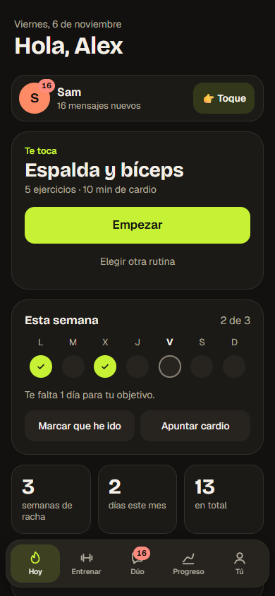
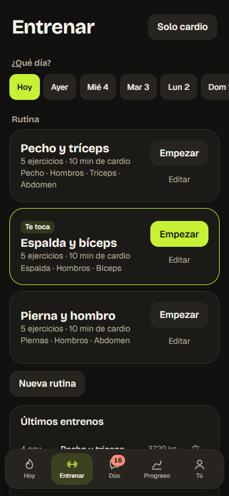
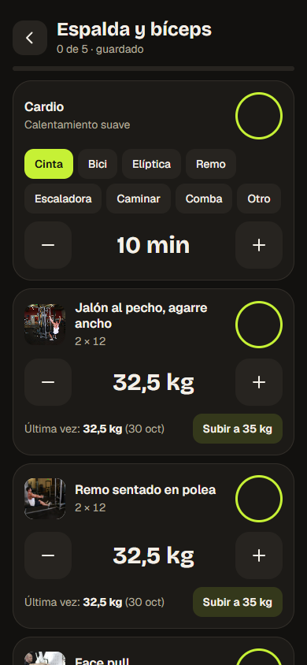
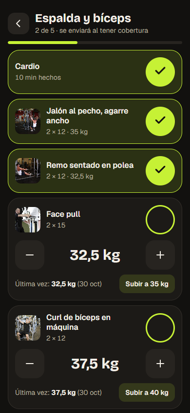
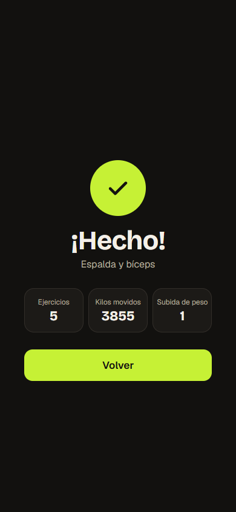
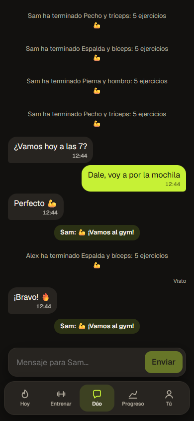
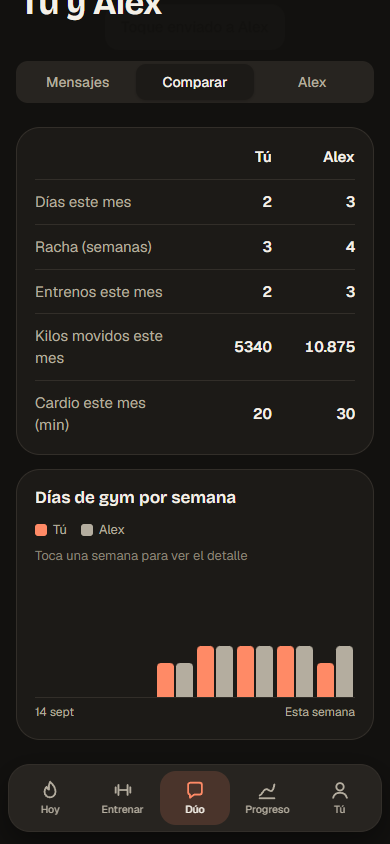
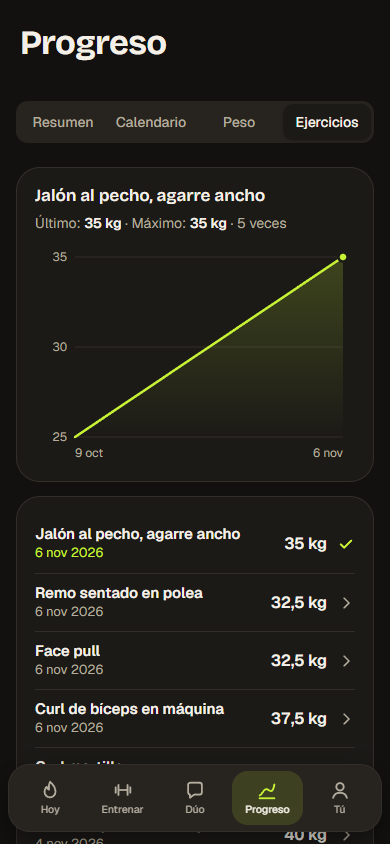
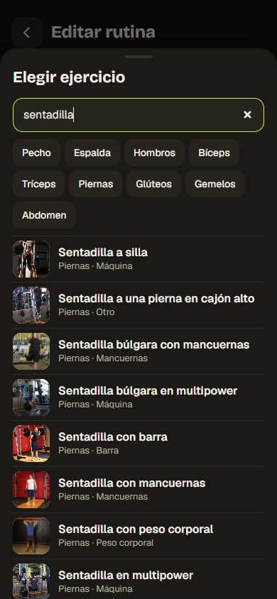

# Documentación de Dúo

| Documento | Contenido |
|---|---|
| [Arquitectura](arquitectura.md) | Cómo encajan las piezas, flujo sin conexión y cómo añadir funcionalidades |
| [Decisiones técnicas](decisiones.md) | Qué elegí, qué dejé de lado y qué problemas aparecieron |
| [API](api.md) | Todas las rutas |
| [Base de datos](base-de-datos.md) | Tablas, relaciones y criterios |
| [Seguridad y privacidad](seguridad.md) | Protecciones y límites conocidos |
| [Desarrollo](desarrollo.md) | Instalar, probar, publicar y regenerar el catálogo |
| [Créditos](creditos.md) | Datos, librerías, fuentes y especificaciones de terceros |

## Capturas

Hechas con cuentas y datos ficticios.

| Inicio | Elegir rutina | Entreno |
|---|---|---|
|  |  |  |

| Sin cobertura | Entreno terminado | Mensajes |
|---|---|---|
|  |  |  |

| Comparativa | Evolución de un ejercicio | Buscador de ejercicios |
|---|---|---|
|  |  |  |
