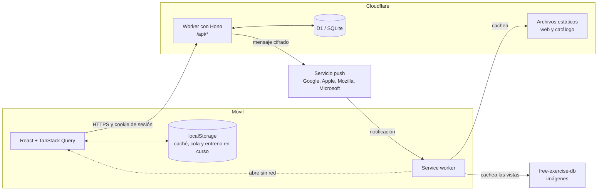
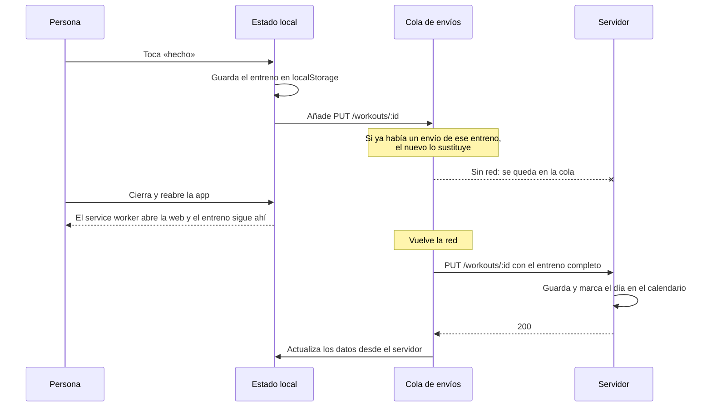

# Arquitectura

Dúo es una aplicación de una sola página (SPA) con una API, publicadas juntas en un único Cloudflare Worker.



## Estructura del código

```
shared/      Tipos y cálculos usados por la web y el servidor (con tests)
worker/      API
  routes/    Una ruta por funcionalidad
  lib/       Sesión, cifrado, validación, push y lecturas comunes
migrations/  Cambios de la base de datos, numerados
src/
  app/       Estructura general y navegación
  features/  auth, today, training, duo, progress, calendar, weight, profile
  ui/        Piezas reutilizables
  lib/       API, cola de envíos, caché y PWA
  styles/    Colores y estilos
public/      Service worker, manifiesto, iconos, catálogo y cabeceras HTTP
data/        Origen del catálogo y traducciones
scripts/     Invitaciones, datos de ejemplo, pruebas y generadores
```

## Marcar un ejercicio sin cobertura

Este es el flujo más delicado: tiene que funcionar en un sótano y no perder ni duplicar nada.



La cola reintenta si no hay red o si el servidor responde con un fallo temporal. Si el servidor rechaza un envío porque no es válido, lo descarta y avisa a la persona.

## Compartir con la pareja

`GET /api/partner` reúne en una sola respuesta lo que la otra persona comparte. El permiso se comprueba en el servidor: lo no compartido llega como `null`, no se oculta en la interfaz.

Las pantallas de resumen y de ejercicios son los mismos componentes para los datos propios y los de la pareja. Reciben los datos por `props`.

## Añadir una funcionalidad

Por ejemplo, medidas corporales:

1. Crear `migrations/0003_medidas.sql`, con `user_id` en cada tabla.
2. Crear `worker/routes/medidas.ts`, con `requireAuth`, filtrando siempre por `c.get("user").id`, y añadir una línea en `worker/index.ts`.
3. Crear `src/features/medidas/` y añadir una línea en `src/app/navigation.tsx`.
4. Si debe verse en pareja, añadirla a `GET /api/partner` con su propio permiso.
