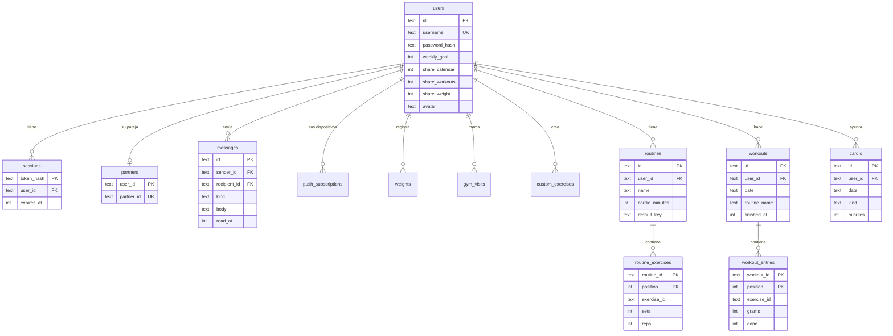

# Base de datos

Cloudflare D1 (SQLite). El esquema está en [`migrations/`](../migrations): cada cambio es un archivo numerado, y uno ya aplicado no se edita.

El diagrama muestra las columnas principales.

## Tablas

| Tabla | Para qué sirve |
|---|---|
| `users` | Cuenta, objetivos y permisos de privacidad |
| `sessions` | Sesiones abiertas. Guarda el hash del token, nunca el token |
| `invites` | Invitaciones de un solo uso. Guarda solo su hash |
| `login_attempts` | Intentos fallidos, para el bloqueo temporal |
| `partners` | Quién es pareja de quién, con una fila en cada sentido |
| `messages` | Mensajes (`text`), toques (`nudge`) y avisos automáticos (`event`) |
| `push_subscriptions` | Dispositivos con notificaciones activadas |
| `weights` | Peso corporal en gramos, uno por día |
| `gym_visits` | Días de gym |
| `custom_exercises` | Ejercicios creados por cada persona |
| `routines`, `routine_exercises` | Rutinas y sus ejercicios |
| `workouts`, `workout_entries` | Entrenos y lo hecho en cada uno, con el peso en gramos |
| `cardio` | Registros de cardio |

## Criterios

- **Cada fila tiene dueño:** los datos personales llevan `user_id` o cuelgan de una fila que lo lleva, y borrar una cuenta borra sus datos en cascada.
- **Fechas:** los días se guardan como `AAAA-MM-DD` en la hora local de la persona, para que un entreno a las 23:30 no caiga en el día siguiente. Los instantes se guardan en milisegundos.
- **Copias de datos:** `routine_exercises` y `workout_entries` copian nombre, músculo y material del ejercicio, así que el historial no depende del catálogo.
- **Catálogo:** no está en la base de datos, sino en [`public/exercises.json`](../public/exercises.json).
